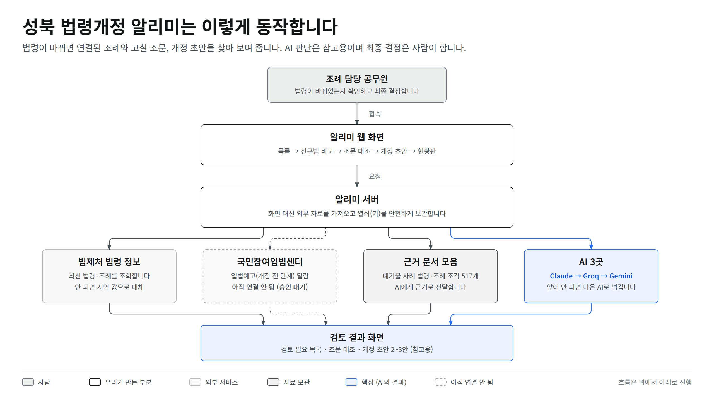

# 성북 법령개정 알리미

법령이 바뀌면 성북구의 관련 조례와 고칠 조문, 개정 초안을 조례 담당 공무원에게 찾아서 보여 주는 AI 알리미입니다.
한성대학교 「AI기반 공공행정 프로젝트 캡스톤 디자인」 수업의 팀 프로젝트(5조)로 만든 시연용 웹 서비스입니다.

## 무엇을 하나요

법률·시행규칙이 바뀌면 구의 조례도 고쳐야 할 수 있는데, 지금은 담당자가 수시로 직접 확인합니다. 이 서비스는 그 확인을 돕습니다. **최종 판단은 항상 담당자가 합니다.**

시연은 실제 사례 한 건으로 합니다. **폐기물관리법 안전기준 위임 사례**를 **시연 기준일 2019. 12. 31.**(시행규칙 제16조의3 시행일)로 돌아가 보여 줍니다. 이 날짜에는 법령은 개정됐지만 성북구 조례는 아직 고쳐지지 않았습니다.

화면은 5단계입니다.

| 단계 | 하는 일 |
|---|---|
| 1. 검토 필요 목록 | 개정된 법령과 연결된 조례를 「검토 필요」로 보여 줍니다 |
| 2. 신구법 비교 | 바뀌기 전과 후의 조문을 나란히 보여 주고, 새로 생긴 내용과 바뀐 곳을 표시합니다 |
| 3. 조문 대조와 사유 | 위임 문구를 찾아 조례의 어느 조문을 고쳐야 하는지 결론부터 보여 줍니다 |
| 4. 개정 초안 | 개정이유, 개정 위치, 개정 문안, 신구조문대비표를 2~3안으로 만들고 Word로 내려받을 수 있습니다 |
| 5. 현황판 | 진행 상태, 담당자, 기한, 협의 부서, 메모, 변경 이력을 관리합니다 |

## 시스템 설계도

위에서 아래로 흐릅니다. 담당 공무원이 웹 화면에서 요청하면 서버가 외부 자료를 가져오고, 그 결과를 합쳐 검토 결과 화면에 보여 줍니다.



- PDF: [시스템설계도.pdf](시스템설계도.pdf)
- 원본(HTML): [docs/시스템설계도/시스템설계도.html](docs/시스템설계도/시스템설계도.html)

## 어떻게 동작하나요

- **알리미 서버(`api`)**: 화면 대신 외부 서비스를 부르고 API 키를 보관합니다. 키는 화면(`public`)에 두지 않습니다.
- **법제처 법령 정보**: 최신 법령·조례 정보를 조회합니다. 조회하지 못하면 이유와 「시연 값」을 함께 보여 줍니다.
- **근거 문서 모음(`docs/답변참고문서`)**: 법령·조례를 조문 단위로 자른 조각입니다. AI는 이 안에서 검색된 조문으로만 답합니다.
- **AI**: Claude → Groq → Gemini 순서로 부르고, 앞이 실패하면(키 없음·오류·시간 초과) 다음으로 넘깁니다. 어느 AI가 답했는지 화면에 표시합니다.
- **현황판 저장**: 입력한 내용은 사용자의 브라우저에만 저장됩니다. 다른 담당자와는 파일로 내보내고 불러와서 나눕니다.

## 지금의 한계

- 시연 자료는 **폐기물 사례 한 건**입니다.
- 시연 기준일(2019. 12. 31.)에 시행 중이던 조례 판의 본문이 자료에 없어, 정비 전 모습이 담긴 **제1349호(시행 2020. 12. 31.)를 대신 사용**합니다. 화면에 「기준일보다 뒤 판」으로 표시합니다.
- 국민참여입법센터(입법예고) 연결은 아직 승인되지 않아 조회되지 않습니다.
- AI 답은 실행할 때마다 달라질 수 있고, 조문 대조에 20~40초 걸립니다. **AI 판단과 개정 초안은 참고용**입니다.
- 현황판은 여러 사람이 실시간으로 함께 쓰는 서버 저장이 아닙니다.
- 실제 도입 때는 상용 AI 서비스 대신 기관 내부에 두는 방식(공개된 오픈 LLM 활용)으로 설계할 것을 권고합니다.

## 실행 방법

Node.js 20.6 이상이 필요합니다(Node.js 24에서 확인했습니다). 외부 패키지는 설치하지 않습니다.

1. 프로젝트 폴더에 `.env` 파일을 만들고 키를 넣습니다. **`.env`는 깃허브에 올리지 않습니다.**

   ```
   CLAUDE_API_KEY=
   GROQ_API_KEY=
   GEMINI_API_KEY=
   LAW_OC=
   LAWMAKING_OC=
   ```

2. 서버를 실행합니다.

   ```bash
   node --env-file=.env dev-server.js
   ```

3. 브라우저에서 `http://localhost:3000`을 엽니다.

키가 비어 있어도 서버는 뜹니다. 그 경우 해당 AI나 공공 API는 건너뛰고 「시연 값」을 보여 줍니다.

배포(깃허브 → Vercel)는 [docs/배포가이드.md](docs/배포가이드.md)를 따릅니다. 가이드에 적힌 AI 키 이름 `GROQ_API_KEYS`, `GEMINI_API_KEYS`(끝에 S)는 옛 이름이고, 지금은 위 표처럼 `GROQ_API_KEY`, `GEMINI_API_KEY`입니다.

## 폴더 구성

| 폴더 | 내용 |
|---|---|
| `public` | 이용자가 보는 화면(HTML·CSS·JS) |
| `api` | 서버 코드: AI 호출, 법제처 호출, 조문 검색, 신구법 비교 |
| `docs/답변참고문서` | AI가 근거로 쓰는 법령·조례 조각 |
| `docs/서비스데이터` | 법령–조례 짝 정보, 검색어 확장 사전 |
| `docs/작업자료` | 법령·조례 원본(.hwp)과 변환 중간 파일 |
| `docs/시스템설계도` | 시스템 설계도 원본과 그림 |
| `scripts` | 원본에서 근거 조각을 만드는 스크립트 ([순서](scripts/README.md)) |

## 데이터 출처

법령·조례 원문은 [국가법령정보센터](https://www.law.go.kr)에서 받은 것입니다. 조각마다 화면용 출처와 원문 링크가 들어 있습니다.
